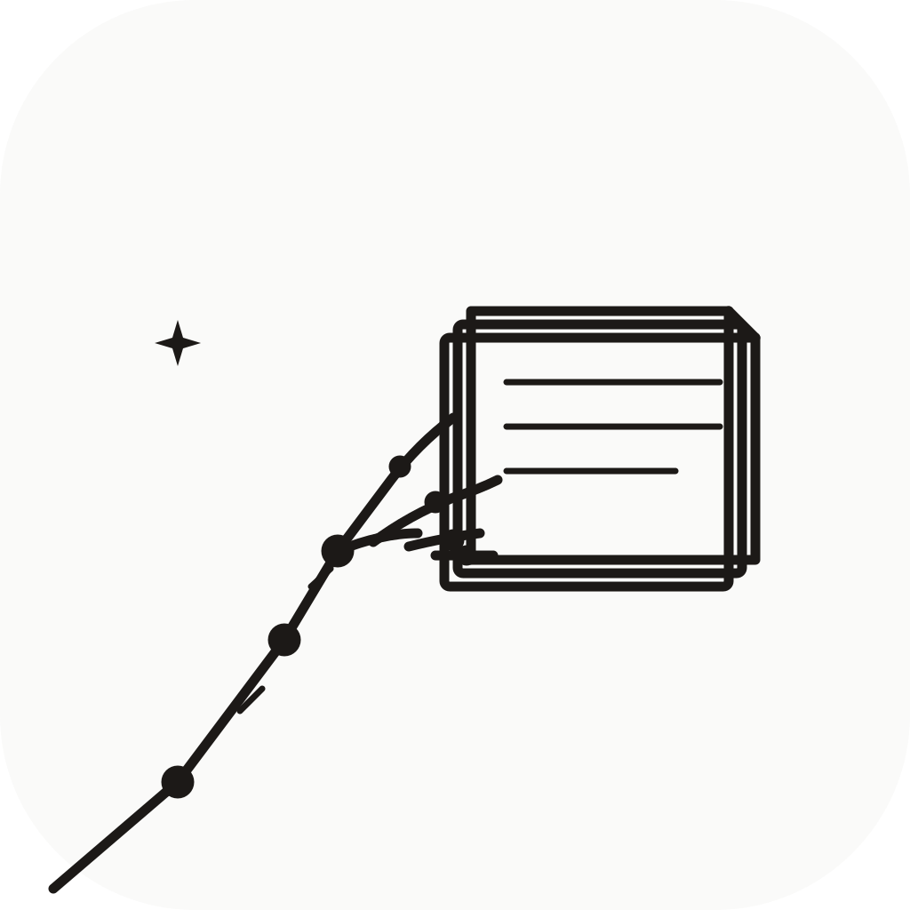
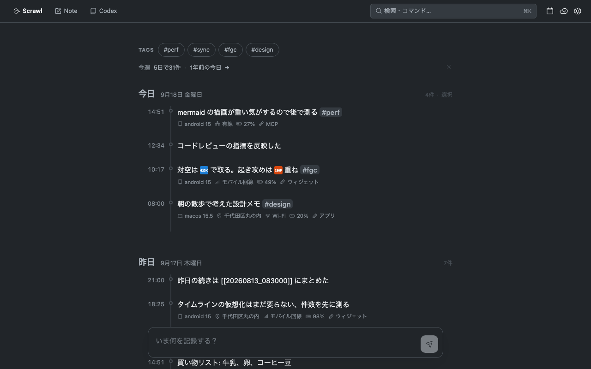

<div align="center">
  
  <h1>Magical Merchant</h1>
  <p>A local-first journal and Markdown workspace — quick capture in Scrawl, Notes that grow out of it. Rust core, Tauri 2 + SolidJS, minimal UI.</p>
  <a href="LICENSE"></a>
</div>



## Features

- **Scrawl** (formerly Timeline) — a day-grouped capture journal with tags, device/place
  context, a calendar jump, and a weekly digest (including _one year ago
  today_)
- **Note** (formerly Notes) — Markdown files that open as a rendered page
  and switch to a Typora-style Milkdown editor on Enter, `e` or a double
  click. A title field that is the body's own `# heading`, autosave with a
  local one-step revert, Shiki code highlighting, Mermaid diagrams, and a
  per-note markmap laid alongside the text
- **Scrawl grows into Note** — promote a Scrawl entry into a note; the two
  stay linked through the note's `origin` frontmatter
- **Note grows into Codex** — a document you keep adding to; it has a
  surface of its own (`⌘3`), keeps the versions you commit, and syncs them
  with everything else
- **`[[links]]` and backlinks** — link notes by immutable file ID with
  autocomplete, optionally with `|display text`; every note lists the records
  that point at it
- **One column, no chrome** — no rail and no tabs. The way around is the
  keys (`⌘1` / `⌘2` / `⌘3`, `⌘K`, `⌘F`, `⌘,`), the places the empty search
  field lists, and a status dot in the window's lower right that carries the
  save and the sync and opens on the open note's details
- **`⌘K` search field** — hidden until called; it opens on kind / tag /
  period chips and the newest records, then searches the full text with
  highlighted matches and lands exactly on the note or the day. **Browse**
  (`⌘F`) narrows across the three surfaces by kind, tag and period, for the
  record whose words you cannot recall
- **Keys you are shown, not told** — hold ⌘ and a badge floats on every
  visible control whose key works right now: the status dot, 新規 and the
  list's pin, the note panel's `…` and its 履歴 tab. `?` opens the palette on
  its command list — the seven global commands, and only those. The
  note-scoped keys the panel has a row for are printed beside those rows;
  `⌘↑` / `⌘↓`, which step through the list, are printed nowhere
- **Optional sync** — Cloudflare Workers + R2, conflict-safe, with Android
  home-screen widgets and an MCP server for AI assistants — read-only unless
  you start it with `--allow-write`
- **Your own editor** — a CLI lists notes and opens one in `$EDITOR`; edits
  go back through the same guarded path as the app, so nothing gets
  overwritten silently. `import` takes in notes written elsewhere, each
  keeping the day it was written, and `sync` runs the same sync as the app
- **Japanese and English** — the interface follows your system language and
  can be pinned either way in Settings

Everything is a plain Markdown file on disk. See the
**[feature tour](docs/features.md)** for screenshots of each surface.

## Quick Start

```sh
# Install on macOS or Linux (Nix)
nix profile install github:Xantibody/magical-merchant
```

```sh
# Develop
git clone https://github.com/Xantibody/magical-merchant.git
cd magical-merchant
direnv allow                       # or: nix develop
cd tauri-app && pnpm install && cd ..
just dev
```

More options (nix-darwin module, manual build, Android APK) are in
[docs/install.md](docs/install.md).

## Documentation

| Page                                 | Contents                                                                                    |
| ------------------------------------ | ------------------------------------------------------------------------------------------- |
| [Feature tour](docs/features.md)     | Every surface, with screenshots                                                             |
| [Architecture](docs/introduction.md) | System overview, design decisions, data flow                                                |
| [Development](docs/development.md)   | DevShell, task runner, browser harness, formatting                                          |
| [Install](docs/install.md)           | macOS (Nix / nix-darwin / manual), Linux (Nix / NixOS / home-manager), Android APK, widgets |
| [Sync backend](docs/sync.md)         | Worker + R2 deployment and the sync protocol                                                |

## Tech Stack

Rust core (`core/`) shared by the Tauri 2 app, a CLI + MCP server (`cli/`),
and benchmarks · SolidJS + Milkdown frontend · Open Props design tokens ·
Cloudflare Workers + R2 sync (`workers/`) · Nix flake for dev/CI/packaging.

```
magical-merchant/
├── core/           # Rust core library (framework-independent business logic)
├── cli/        # Terminal client ($EDITOR editing) + MCP server
├── tauri-app/
│   ├── src/        # SolidJS frontend (TypeScript)
│   └── src-tauri/  # Tauri 2 backend (Rust)
├── workers/        # Cloudflare Workers (R2 sync backend)
├── docs/           # Documentation
├── rust/           # Shared Rust just recipes
└── nix/            # Nix configuration helpers
```
