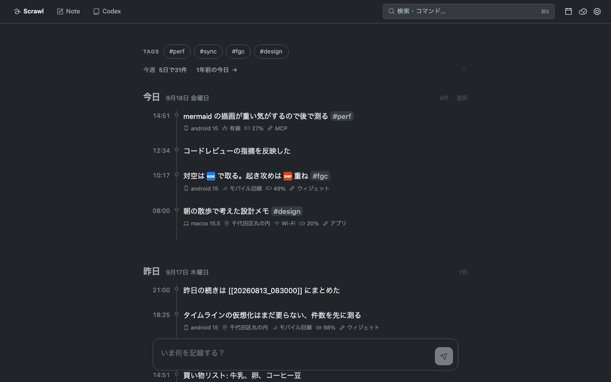
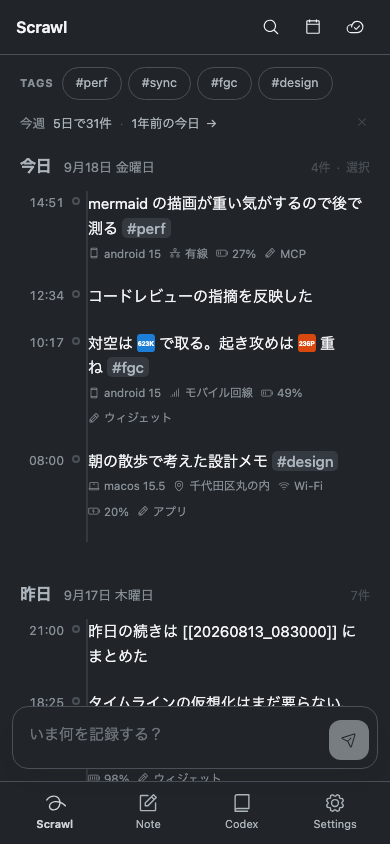
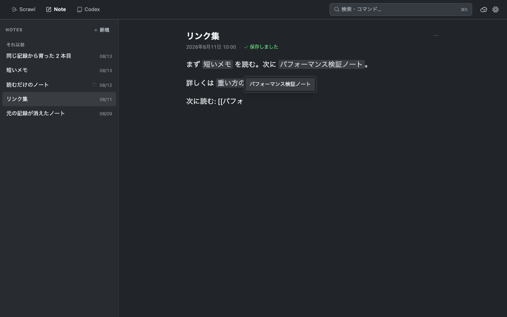
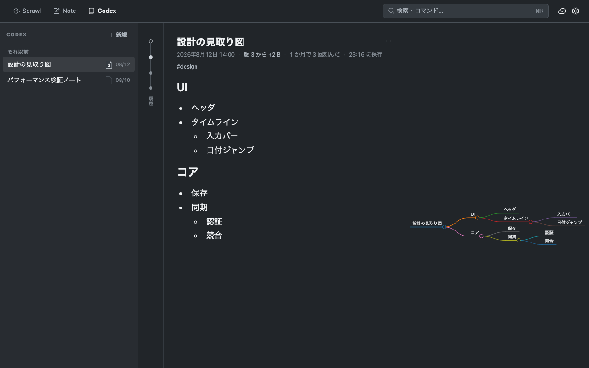
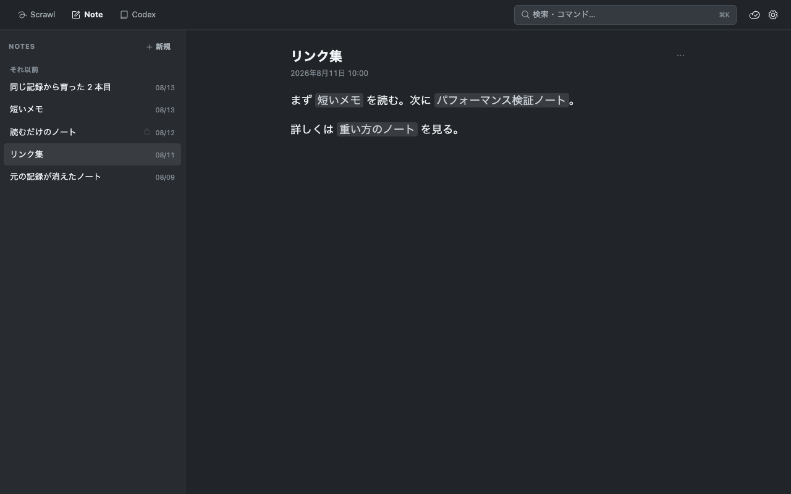
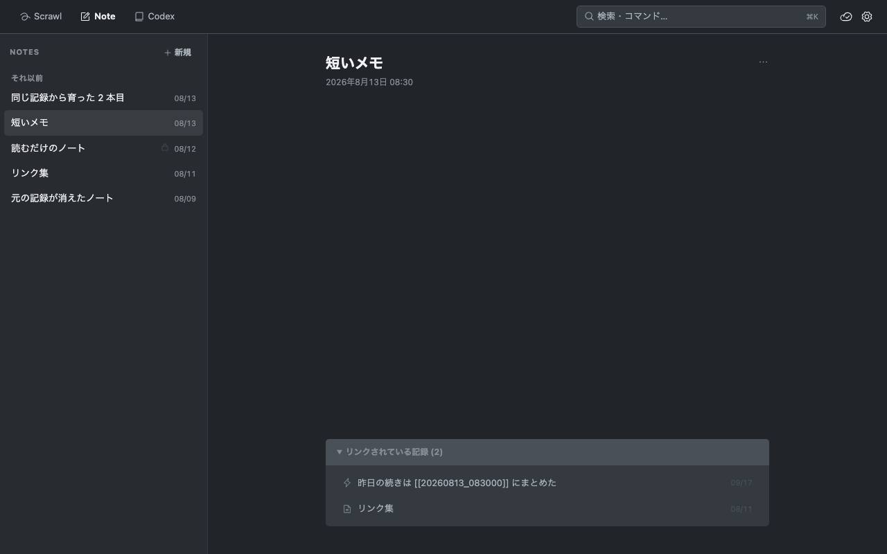
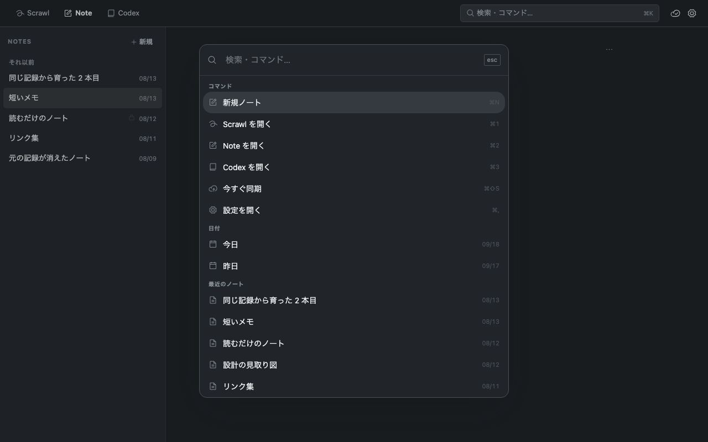

# Feature Tour

A walkthrough of every surface in Magical Merchant. Screenshots are taken
from the browser verification harness with fixture data.

## Scrawl — a journal that captures first

Scrawl (formerly Timeline) is a single-column, day-grouped journal. The input
line at the top of today is always ready: type, send, and the entry lands
there with a timestamp. Entries record the device context they were written
in (device, network, battery, and a place name resolved from the coordinate).
Tags typed as `#tag` gather as chips at the top; pressing one opens the search
field with that tag, so the journal itself never filters. The calendar jumps
to any recorded day, and the line's `/` menu (探す · Note を作る · 日付へ)
reaches the same places without leaving the keyboard — it answers to those
row names only, so `/tmp` stays a record.



At the top, a **weekly digest** appears once per week: one line saying how
many entries on how many days and — when that day has entries — a jump to
_one year ago today_. It sits under the tag chips rather than above them, so
a digest that arrives late never pushes the chips down. Dismissing it hides
it for the rest of the week, per device.

### Mobile

The same journal on a phone. A 48px header holds the title, the calendar, the
search and the status dot; the other screens are reached through the empty
search field and the dot's details, and the input line scrolls with today.



### Promote an entry into a note

When a quick capture grows into something bigger, promote it: hover an entry
(PC) or long-press it (touch) and choose Note にする. A new note opens ready
to write, carrying the entry text and tags. The note's frontmatter records the
origin entry, and Scrawl shows a chip (📄 title →) on that day linking
to the note — derived on every render, so reordering or deleting entries never
breaks the link.

## Note — a Typora-style Markdown workspace

Note (formerly Notes) holds plain Markdown files. The **list** is a 280px
flyout: rest the pointer on the window's left edge and it floats in over the
body, one line per note grouped by how recently it was created; a pin, or
`⌘\`, keeps it out. The body column never moves when it opens. A note opens
in the **viewer**: the title as a heading, a meta line of created time and
tags, the rendered body, then the records pointing here.

Enter, `e`, a double click or the pencil in the strip over the page opens the
**writing screen**: the Milkdown editor under a **title field** that _is_ the
body's leading `# heading` — there is no separate title in the frontmatter,
so the file stays readable in any Markdown tool and the heading can never
drift from the title. Esc or the check comes back to the viewer, and the URL
carries which one you are on (`edit=1`), so back and forward move between
them. Saving is automatic (debounced), and the first content-changing save of
a session keeps the pre-edit body on the device, so 編集前に戻す (`⌘⇧R`) can
undo an accidental edit — press it again to swap back. It sits in the note's
panel, and in the status dot's details whenever there is something to go back
to.

Note-level settings and actions live in a **panel at the right edge**,
because none of it is used often enough to sit in the way of writing. The
`…` in the viewer's strip, or `⌘.`, docks it so the body makes room; the
writing screen has no way into it. It holds the view switches (マップ, and
記入例 for a note from a template), the tags, the note's details, and the
rare actions: revert, Codex にする (behind a confirmation, since there is no
way back), delete. While it is closed the **status dot** at the window's
lower right wears the save and the sync — green, grey, red — and pressing it
says what the panel would: the save time, and every state that is on — press
one to open the panel on its switch. On a phone the panel is a screen of its
own, and a status row under the title keeps the save and the states as pills.

Tags are edited in the panel: chips, with the tags you have used before
offered as you type. The meta line in the viewer only shows them. A `#tag`
written in the body shows in both places without an ×; it lives in the body
and is removed there.

The panel's 詳細 (`⌘⇧I`) is where a note's records live: the creation time
(editable), the device context it was captured on, and — once the body has
been rewritten at least once — the **update time**. Creation time is
pinned to the filename order, so the update time is the only place a rewrite
shows up. Changing metadata or the view mode is not a rewrite and leaves it
alone.

There is no read-only mode to park a note in: every note opens as a rendered
page and is written only after you ask. A frontmatter `view: preview` left by
an older release stays in the file and now means nothing more than the
default.



The table button above the body inserts a table at the cursor. Selecting a
cell moves the button beside its row; opening the menu highlights the target
row and column, including when inserting in the middle of a table. Inside a
cell, the same menu adds or deletes rows and columns, aligns a column,
exits the table, or deletes it. Undo is available in the menu on phones as
well as through the usual keyboard shortcut. The header and the last body
row are protected; delete the whole table when it is no longer needed.
Tab and Shift-Tab move between cells, and Tab in the last cell adds a row.
Enter moves below the table; Shift-Enter adds a line break within a cell.

Code blocks are highlighted with Shiki; a ` ```diff ` fence colours its `+`
and `-` lines instead. ` ```mermaid ` fences render as diagrams, and a leading
`%% caption: …` comment inside the fence becomes the figure's caption —
mermaid skips `%%` lines, so the note still draws anywhere else. Hovering a
code block or a figure reveals a small toolbar: copy the code, or open the
diagram full screen and save it as SVG or PNG (the file is named after the
note and the diagram's position). The full-screen view zooms around the
cursor with the wheel or a pinch, drags to pan, and closes with Esc. A
per-note **map** — the panel's マップ switch (`⌘⇧M`), frontmatter `view: mindmap` —
turns the heading and list structure into a markmap. It is laid _alongside_
the body rather than in place of it, so the text you are reading it against
stays on screen; only below 1100px, where there is no room for two, does it
take the body's place:



The map itself is the same on either surface, Note or Codex.

## Note links and backlinks

Type `[[` in the editor and an autocomplete popup offers your notes. The
stored form is `[[YYYYMMDD_HHMMSS]]` — the filename is an immutable ID, so
links survive title changes. The editor and preview render links as the
target's current title; click one to open the note. Write
`[[YYYYMMDD_HHMMSS|display text]]` when the title does not fit the sentence —
the link still points at the same note. A link whose target is gone stays
visible as its raw stored form rather than pretending to be a note.



Every note shows the records that link to it — other notes and Scrawl
entries alike — in a collapsible リンクされている記録 footer. Backlinks are
derived by scanning at read time; there is no index to corrupt or sync.



## Codex — a Note that keeps growing

Some notes are never finished: a reading log, a project journal, a page you
keep adding to. Codex is its own surface (`⌘3`, `/codex`) for exactly
those. Any Note becomes a Codex from its panel; the file keeps its ID and
every link to it, it just moves from `data/notes/` to `data/codex/`. The move
is one-way — a Codex is defined by the history it accumulates, and that
history has nowhere to go if the document turns back into a plain Note.

A Codex opens the same way as a Note — the same viewer, the same writing
screen on Enter, the same autosave. What it adds is on purpose: the body is a
draft until you commit a version, and the versions travel with the file
through sync, so the history is the same on every device.

Three things tell a Codex from a Note, and none of them is a mode you have to
enter:

- **The list row** carries a folded-corner page with the number of versions
  in it. Its frame says which of three states the document is in — no
  versions yet, versions and the draft matching the newest one, or the draft
  having moved on since then. The row stays one line.
- **The meta line** reads how far the draft has travelled — 版 4 から
  +312 B ("+312 B since v4"), 版 4 when it matches the newest version, 版なし
  before the first.
- **The panel gets a second tab**, 履歴, topped by how often you commit:
  9 か月で 4 回刻んだ ("4 versions in 9 months"). The version list is in
  there, and nowhere else.

Nothing is committed for you, and committing asks nothing of you. 版を刻む —
in the panel, and in the status dot's details whenever the draft has
moved on (`⌘⇧K`) — flushes whatever save is still in flight and writes the
version at once — no message prompt, because a version is named by its number
and its day, and being asked for a sentence is what stops people committing at
all. The toast that follows does the summarising (版 5 を刻みました · 版 4 から
+312 B · 7 日ぶり) and carries an Undo that deletes the file just written.

The panel's second tab, 履歴 (`⌘⇧H`), docks the panel and opens the version
list beside the body rather than replacing it; the panel always opens on its
first tab, so a comparison never appears in passing. The body stays where it
is, read as it was, and the difference between the version you picked and the
draft appears in its margin: a `+` beside every block that changed, a `−`
beside every block that is gone — struck through and faint, in the place it
used to occupy. Walk the versions in the list and the marks move with them;
`Esc` closes the history. On a phone the history is the panel screen's second
tab and a compare bar sits under the body. この版に戻す makes that version
the draft again, and the draft you are leaving is committed first as
_before restore_, so a restore is itself undoable from the same list.

On disk a version is
`data/codex/<id>/<YYYYMMDD_HHMMSS>-<first 8 hex of the body's SHA-256>.md`:
plain Markdown with `time` and `message` frontmatter, so `diff -u` in a
terminal works as well as the app does. The app leaves `message` empty — the
only one it writes is `before restore`, and the history shows that version as
戻す前 instead of a date. Committing the same body twice in the same second
on one device is one version: the file is already there and comes back
untouched. Two devices are not that story. The name carries the committing
device's wall clock cut to the second, so two devices on different offsets
write two names for the same instant and the same body, and the history
shows two rows. Line the offsets up and the names do match — but `time` in
the frontmatter is the full timestamp, nanoseconds and offset included, so
the bytes differ, and sync meets a key it has no record for whose two sides
disagree: that is a conflict. The local copy keeps the key and the other is
set aside under `conflicts/codex/<id>/<version>/<timestamp>.md`, outside
`data/`. Nothing is lost either way; what you get is a version that did
not fold. Versions are not the local `history/` copies the CLI and MCP
take before overwriting — those are a safety net on one device; versions
are part of the document and sync with it.

## Glyphs — your own inline symbols

Some things have no character: fighting-game command notation, a custom
mark, a logo. Register a small PNG or SVG under a short name in
Settings → GLYPHS and write `:name:` anywhere — a Note or a Scrawl entry —
to show it inline, the way an emoji shortcode works. The preview, the
editor and Scrawl all render it; the editor shows the source text
again when the caret touches it, so the stored Markdown stays plain text.

Only registered names render: `12:30:45` and an unknown `:foo:` stay as
written, and a shortcode inside a code span or fence is left alone. The
images live under `data/glyphs/` next to the notes, so sync carries them to
every device; a device that has not received an image yet simply shows the
text. Names are lowercase (`a-z 0-9 _ + -`, up to 32 characters) and images
are capped at 256 KB. To register many at once, pick a whole folder (or
several files) — each PNG/SVG is named after its file stem, an existing name
is overwritten, and anything unusable is counted as skipped; files dropped
straight into `data/glyphs/` are picked up as well.

## Search field

`⌘K` opens the search field. It is hidden until called and floats over
whatever you were on, so an open note stays where it was; Esc gives the keys
back. Before you type anything it shows the kind / tag / period chips and the
newest records, so it can be browsed by hand. Typing on Scrawl or Browse opens
it too, as does `/ 探す` on Scrawl's input line. Results highlight the matched
text in a context snippet, and the only thing a result does is open — a note
opens that note, a Scrawl hit scrolls to that day; Enter takes the first.

Searches can be scoped to tags, from any screen. Every `#tag` you type counts
as scope rather than text: `#SF6 #ベガ #置き攻め` lists every note and entry
carrying all three tags (AND), and `#sf6 コンボ` looks for "コンボ" only
inside `#sf6`. Tags are matched the way the chips are, so `#SF6` and `#sf6`
are the same tag. Pressing a tag chip on Scrawl opens the field with that
chip already set; a chip is removed by clicking it, or with Backspace in an
empty field (last chip first). A bare word also answers with the app's
commands above the records, and the empty field lists the places — Scrawl ·
Note · Codex · 絞る · 設定 — which is how the other screens are reached on a
phone.

## Browse

絞る (`⌘F`, `/browse`) is one screen that looks _across_ the three surfaces
by kind, tag and period, for the record whose words you cannot recall. The
chips on the left carry counts, taken over the other axes, so a chip's number
is always "how many if I press this"; several kinds or tags can be chosen at
once (OR, where the search field is AND). The matching records list newest
first, and the one selected is shown in full on the right. **It has no text
search** — typing on it opens the search field. Every row leads back to the
surface the record lives on; a phone drops the preview column.

## Command palette

`?`, pressed anywhere you are not typing, opens the palette on the app's
**commands** — new note, the three surfaces, Browse, sync now, settings —
each with its key down the right-hand side, with a full-text search below.



## Keyboard

There is no cheat sheet to look up, because the app can show you the keys in
the place they belong. There is no rail and no tab bar either: the way around
is the keys, the places the empty search field lists, and the **status dot**
— hover it and Scrawl · 検索 · Settings · キー appear to its left. Hold ⌘
(Ctrl on anything that is not a Mac) for a moment and a badge floats on the
shoulder of every visible control whose key works right now — the status dot,
新規 and the pin in the list, the `…` over an open note and its 履歴 tab, the
two actions in the status details — with a pill explaining how to make them go
away; let go and they are gone. And `?`, pressed anywhere you are not typing,
opens the palette on the command list.

The ones worth learning first:

| Key                | What it does                  |
| ------------------ | ----------------------------- |
| `⌘K`               | The search field              |
| `⌘F`               | Browse                        |
| `⌘N`               | A new note                    |
| `⌘1` / `⌘2` / `⌘3` | Scrawl / Note / Codex         |
| `⌘\`               | Pin the list open             |
| `⌘.`               | Dock or fold the note's panel |
| `⌘⇧S`              | Sync now                      |

The palette's command section holds the seven global commands and nothing
else — a new note, the three surfaces, Browse, sync now, and `⌘,` for
Settings. The keys that need a note open are not in it: they are written
beside the rows of the note's own panel, the one `⌘.` docks — `⌘⇧M` for the
map, `⌘⇧R` to revert, `⌘⇧I` for its details, `⌘⇧K` to commit a Codex version,
`⌘⇧H` for a Codex's history. `⌘↑` / `⌘↓` walk the list and are printed nowhere
at all; they answer only while the caret is outside every field you can type
in — not just the title and the body, but the search field, the tag input in
the panel and the created time in 詳細 as well — so they step through notes
once you have clicked away from what you are writing. With the caret in any
of them they are left alone, and stay the jump to the top or the bottom of
what you are typing. Where a Mac reads ⌘⇧, every other platform reads
Ctrl+Shift.

The badges, the palette's right-hand column, the keys in the note's panel and
the key handling itself all read one table in
[`tauri-app/src/lib/shortcuts.ts`](../tauri-app/src/lib/shortcuts.ts),
so a key that is written in two places cannot come to mean two things.

## Language

The interface speaks Japanese or English. It follows the system language on
first launch and can be pinned either way in Settings → LANGUAGE; the choice
takes effect immediately, without a restart. Place names follow it too: the
OS geocoder is asked in the chosen language, and the cache remembers which
language each answer came from. Only the interface changes — what you wrote
stays exactly as you wrote it, and so do your tags and the coordinates behind
those place names.

On macOS, Settings → WINDOW adds _Start in fullscreen_: the app opens in the
native fullscreen (its own Space, like the green button) from the next launch.

## Sync (optional)

A Cloudflare Worker + R2 backend syncs the Markdown files across devices.
Conflicts keep the local copy and preserve the loser under `conflicts/`,
outside the synced tree. See [sync.md](sync.md) for deployment and the
change-detection protocol.

## Android widgets

Five home-screen widgets ship with the APK:

| Widget            | Size      | What a tap does                                                                                                              |
| ----------------- | --------- | ---------------------------------------------------------------------------------------------------------------------------- |
| Scrawl に記録     | 4×1       | Opens a sheet over the home screen and appends to today's Scrawl through a JNI call into the core — the app is never started |
| 新しい Note       | 4×1       | `magical-merchant://widget/new-note`                                                                                         |
| 最近の Note       | 4×2       | The four newest notes; a row opens that note, the header plus makes a new one                                                |
| テンプレート      | 4×2       | A grid of four templates; a cell creates a new note from it                                                                  |
| テンプレート 1 つ | 2×1 / 1×1 | One template chosen when the widget is placed; a tap creates today's note from it                                            |

All five are deep links into the app except the capture bar, which is the one
that exists so that recording costs nothing — no launch, no wait.

## Terminal (CLI)

`magical-merchant` is a small command-line client over the same core, for
the days you would rather write in your own editor:

```sh
nix run github:Xantibody/magical-merchant#cli -- list
magical-merchant show                  # the newest note
magical-merchant edit 20260320_143045  # opens it in $VISUAL / $EDITOR
magical-merchant edit --last           # the newest note; `edit` never guesses
echo "# Idea" | magical-merchant new   # or: magical-merchant new --title Idea
magical-merchant import --time 2019-05-04T12:00:00+09:00 < old-note.md  # keeps that time as the ID
magical-merchant scrawl add -m "shipped it #work"   # capture; without -m, opens the editor
magical-merchant scrawl show [2026-03-20]           # one day, today if omitted
magical-merchant sync                  # same sync the app runs, without opening it
```

`edit` hands the editor the Markdown body only — the frontmatter is the
app's record and is never shown — and writes it back through the same path
the MCP tools use: a copy of the previous version goes to `history/` first,
and the write is refused if the note changed while the editor was open (in
the app, by a sync, by an agent). Nothing typed is lost: the edited text
stays in a scratch file whose path is printed. Closing the editor without
changes writes nothing. The app, in turn, refuses to overwrite a note the
CLI changed while it was open, reloads it, and keeps the typed text behind
its Revert button.

`import` is the way in for notes written somewhere else. A note's filename
is its creation time and its permanent ID, so anything moved in would
otherwise be stamped with the day it was moved; `--time` keeps the day it
was written, `--tag` and `--template` fill in the frontmatter, and the
filename it lands under is printed so a migration script can keep a map.
The body comes from stdin only — nothing about any particular source
format lives in the app, which is a conversion script's job.

`sync` runs the app's own sync engine from the terminal, reading the server
URL and the login the app saved — it never asks for either, so there is one
place where sync is set up — and it stops with "log in again from the app" as
soon as that login has expired. A large sync goes in rounds of at most 40
operations (an upload or a download is one, a conflict three), and each round
prints how far it got and how much it deferred to the next one; the app runs
the same rounds behind its button, silently. Anything short of a clean sync
exits non-zero; a run that reaches the end also lists the files it could not
handle, while one that gives up part way prints only why it stopped. If the
app is syncing at that moment, the CLI says so and exits 1 rather than
waiting.

`scrawl add` appends to today through the same core call the Android
widget uses; it only ever appends, so it needs no revision check. `-m` is
the one-liner, a pipe is read as the entry, and with neither the editor
opens.

Anything written from the terminal records the same device context the app
records — OS and version, machine name, locale, battery, and network type —
so what a record says about the machine does not depend on which surface
wrote it. The coordinate is the exception: measuring one costs a permission
prompt and a wait that a command running once cannot pay, and reusing the
app's last fix would claim you wrote somewhere you were not, so records
written from the terminal carry no location.

The CLI finds the app's data directory on its own; `--data-dir` or
`MAGICAL_MERCHANT_DATA_DIR` overrides it.

## AI access (MCP)

`magical-merchant mcp` exposes the same core as
[Model Context Protocol](https://modelcontextprotocol.io/) tools for AI
assistants; `nix run …#mcp` is that command. It is read-only by default and
says so in the instructions it hands the client. It finds the app's data
directory on its own, so the usual client configuration is just the launch
command:

```json
{
  "mcpServers": {
    "magical-merchant": {
      "type": "stdio",
      "command": "nix",
      "args": ["run", "github:Xantibody/magical-merchant#mcp"]
    }
  }
}
```

Every record comes back with the device state captured when it was
written — local time, GPS coordinates (and the place name the app resolved
for them), battery, network type, and which device wrote it — so an agent
can line the journal up with other time- or location-based data.

| Tool                  | Description                                                                                        |
| --------------------- | -------------------------------------------------------------------------------------------------- |
| `list_notes`          | List all notes with their `kind` (`note` / `codex`), tags, a short preview, and their origin       |
| `read_note`           | Read a note's metadata (time, tags, context) and Markdown body                                     |
| `backlinks`           | List the records that link to a note with `[[…]]`                                                  |
| `search`              | Search notes, codex and Scrawl entries, optionally within a set of tags; each hit says which it is |
| `list_scrawl_dates`   | List the dates that have Scrawl entries                                                            |
| `read_scrawl`         | Read one day's entries with time, text, tags, location, and device                                 |
| `read_scrawl_range`   | Read entries between two days, optionally filtered by tag                                          |
| `list_places`         | Places (~1 km cells) records were written at, with names and counts                                |
| `list_tags`           | Every `#tag` with note and entry counts                                                            |
| `list_templates`      | List note templates                                                                                |
| `read_template`       | Read a template's body and tags                                                                    |
| `list_glyphs`         | Registered glyphs with the `:name:` shortcode that renders each one                                |
| `list_codex_versions` | A Codex's committed versions, newest first, and how far the draft has moved                        |
| `read_codex_version`  | Read the body of one committed version                                                             |
| `diff_codex_versions` | Unified diff between two versions, or from a version to the draft                                  |

An agent can read a Codex's history but not make it: no launch offers a
tool to commit, delete or restore a version, `--allow-write` included.
Committing is a person saying "this far", which is not a decision to hand
to a model, and restoring commits a version as a side effect. Reading the
versions needs no flag because they are part of the document; the local
`history/` copies are the opposite case; their tools sit behind
`--allow-write` because they exist to undo what those tools wrote.

With `--allow-write` the server also offers writing tools, and its
instructions say so instead of claiming to be read-only. Notes are
plain Markdown, so a body can hold anything the app renders — Mermaid
diagrams in a fenced `mermaid` block, `[[YYYYMMDD_HHMMSS]]` links to other
notes, `#tags`, `:name:` glyph shortcodes (ask `list_glyphs` for the
vocabulary). The server writes the frontmatter itself and keeps it intact
on updates; the body is all a client sends. A Codex's draft is written the
same way: `update_note` resolves the ID with `locate_note`, which looks in
`data/codex/` before `data/notes/`, so an agent edits the body of a
document that keeps versions without having to know it is one, and
`list_note_history` / `restore_note` reach it too. `create_note` only ever
writes into `data/notes/`; `create_codex` makes a Codex, and
`promote_to_codex` turns a Note into one, for good. A Codex made this way
starts with no version until a person commits one.

Every overwrite first saves a full copy of the previous version under
`<data-dir>/history/` (outside the synced `data/`), so any change an
assistant makes can be brought back. The newest 20 copies of each note are
kept; older ones are dropped as new copies arrive, and a note's copies
outlive the note itself. `read_note` also returns a `revision`
of the body; pass it to `update_note` and the write is refused if the note
changed in between (in the app, from the CLI) instead of overwriting that
edit:

| Tool                | Description                                                                                                         |
| ------------------- | ------------------------------------------------------------------------------------------------------------------- |
| `create_note`       | Create a note from a Markdown body (first line `# Title`)                                                           |
| `create_codex`      | Create a Codex from a Markdown body                                                                                 |
| `promote_to_codex`  | Turn a note into a Codex, keeping its ID and body; there is no way back                                             |
| `add_scrawl`        | Append an entry to today's Scrawl; it cannot be edited or removed from here                                         |
| `update_note`       | Replace a note's body, optionally only if its `revision` still holds                                                |
| `list_note_history` | List the saved copies of a note, newest first                                                                       |
| `read_note_history` | Read one saved copy, with the note's current `revision`                                                             |
| `restore_note`      | Bring a note back to a saved copy, optionally only if its `revision` still holds (the current version is saved too) |
| `save_glyph`        | Register or replace a glyph image (png/svg, base64, up to 256 KiB)                                                  |

| Flag / variable                                  | Description                                                         |
| ------------------------------------------------ | ------------------------------------------------------------------- |
| `--data-dir` / `MAGICAL_MERCHANT_DATA_DIR`       | Override the data directory (default: the app's own data directory) |
| `--locale` / `MAGICAL_MERCHANT_LOCALE`           | Preferred language for place names, `ja` or `en` (default `en`)     |
| `--allow-write` / `MAGICAL_MERCHANT_ALLOW_WRITE` | Offer the writing tools (off by default)                            |

Scrawl times are the recording device's local wall-clock time without a
UTC offset; note times are RFC 3339 with the offset. Place names come from
the app's own geocoding cache — the server never calls a network service.
